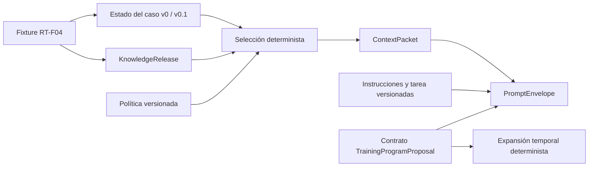

# RG-DAS S1A — Informe de implementación

Fecha de referencia: 18 de octubre de 2026, America/Tijuana.

**Resultado técnico:** contratos de prescripción, conocimiento, contexto y envelope implementados dentro del backend. Verificación: 50 pruebas satisfactorias, tipado estricto, build y lint sin errores ni advertencias. No se implementaron generación LLM, persistencia, endpoints o revisión profesional en S1A.

## A. Estado inicial y aislamiento

| Elemento | Evidencia |
| --- | --- |
| Repositorio | `Enduren-uabc/back-enduren` |
| PR #6 | Abierto, borrador, rama `feat/research-ai-domain-v0-20261015` |
| HEAD remoto del PR #6 | `44c88dae98074fadfe7ffb2d846e36b0a0c9d360`, sin cambios frente a la solicitud |
| `master` remoto | `b828dc7412a928cef61243334868c79a7ebe97da` |
| Base efectiva de S1A | HEAD exacto del PR #6, no `master` |
| Clon independiente | `/home/otomi/UABC/octavo_semetre/Auditory-Endure-App/rg-das-s1a` |
| Git propio | Directorio `.git`, también `git-common-dir`; clon normal, no worktree ni repositorio compartido |
| Rama nueva | `feat/rg-das-s1a-context-contracts` |
| Estado al crear la rama | Árbol limpio |

Se descargó el clon de GitHub. El intento inicial terminó con código 128 por resolución DNS; el reintento autorizado terminó con código 0. No se usaron como base las ramas #7, #10 o #11. Los checkouts originales quedaron fuera de las operaciones de escritura.

Se reutilizó `CaseStateSnapshot` v0, sus cinco pruebas y su serialización. En los dos archivos heredados sólo se ajustaron formato, el tipo explícito `unknown` del recorrido de congelación y una comprobación opcional equivalente. El contrato v0 conserva versión y campos.

Para verificar sin cambiar manifiestos se copió al clon un `node_modules` existente. Su `pnpm-lock.yaml` y el del clon son idénticos (comparación con código 0). Se utilizó Node `v22.23.3`. No equivale a una instalación desde cero en CI. El código de los PR de workout del entorno de origen no se copió: sólo sus dependencias, consistentes con el lockfile.

## B. Arquitectura

**Decisión:** funciones puras TypeScript dentro del monolito NestJS existente, con transformación explícita y validación en ejecución. Sin nuevas dependencias, servicios externos ni cambios de configuración Nest. Un motor de workflows o una jerarquía de estrategias no resuelve una variación presente en S1A.

**Patrón:** ninguno de GoF; factories validadoras y una secuencia determinista son suficientes. El envelope define la frontera futura con el proveedor, sin crear un gateway ficticio.

Vista de dependencias, no infraestructura desplegada ni diagrama UML formal:



El caso contiene hechos/ausencias, fuente y tiempo; el conocimiento contiene catálogo, claims y reglas. Selección usa hechos admitidos para determinar aplicabilidad y registra exclusiones. El envelope conserva instrucciones separadas de datos. No se importan entidades operativas, TypeORM o proveedores. La prescripción representa contenido; todavía no es el agregado publicado/persistido `SystemProposal`.

`contract.ts` es un vocabulario cerrado de campos para compartir validación y generación de JSON Schema, no un intérprete universal de esquemas. Las invariantes relacionales permanecen en sus contratos de dominio.

Coste principal: ordenación/serialización para hashes, aproximadamente O(n log n) en las colecciones ordenadas; expansión proporcional a semanas × ocurrencias × series. La expansión exige un límite de semanas del llamador. No se añadieron cachés. El límite de contexto controla el resultado, no sustituye límites futuros sobre el tamaño de entrada de una API.

## C. Contratos y validaciones

### Estado del caso

`research-case-v0` permanece vigente. `research-case-v0.1` añade edad, días concretos, duración en segundos, restricciones de salud, historial de carga y técnica. Cada detalle exige un valor conocido con procedencia o un estado explícito de ausencia. No se infiere historial desde experiencia.

Ambas versiones son admitidas por Context Intelligence. Se verifican tipos, estados, procedencia, timestamps y días duplicados. La discrepancia entre cantidad de días y días concretos se registra como conflicto. No se ejecutan migraciones ni lecturas de perfiles.

### TrainingProgramProposal — `training-program/0.1`

Conserva identidad, caso/snapshot, release, horizonte en semanas, sesiones, ejercicios, series y omisiones. Identidad y orden son distintos. Dos variantes comparten el contrato:

- `WEEKLY_TEMPLATE`: plantilla, continuidad explícita y reglas de reemplazo de series por semana/ejercicio de plantilla.
- `EXPLICIT_WEEKS`: sesiones y dosis individualizadas por semana.

Cada serie representa repeticiones exactas o rango; intensidad RIR, RPE con escala, carga absoluta kg o porcentaje de 1RM; descanso entre series. Cada ejercicio conserva descanso entre ejercicios. No se suman implícitamente ambos descansos en una transición final. Ausencias de dosis se expresan como `UNSPECIFIED` o `NOT_APPLICABLE` con motivo, nunca cero inventado.

Se rechazan duplicados de identidad/orden en su ámbito, referencias de catálogo inexistentes o de otra versión, vínculos erróneos de snapshot/release, semanas fuera de horizonte, rangos invertidos, RPE fuera de escala y reglas temporales superpuestas o con objetivos inexistentes. B debe representar cada semana del horizonte a nivel de calendario. El JSON Schema cubre estructura; el factory añade invariantes relacionales.

Las listas de sesiones/ejercicios pueden estar vacías: no hay un mínimo científico impuesto ni una puerta de aceptabilidad. Omisiones globales se describen en `omissions`; omisiones de dosis se conservan en su componente.

La expansión `weekly-template-expander/0.1` crea un objeto congelado nuevo, referencia su propuesta fuente y conserva identidad lógica semana/sesión/ejercicio/serie, por ejemplo `W3/SB/SB-E3/set-2`. Compartir catálogo no implica compartir ocurrencia. El límite de expansión se suministra explícitamente y no fija cuatro semanas.

No hay editor o sesión de revisión. La prueba localizada construye una segunda propuesta B y comprueba aislamiento del cambio. El subconjunto temporal ejecutable es un calendario de reemplazos de series; no interpreta reglas en lenguaje natural, condiciones clínicas o adaptación a resultados futuros.

### KnowledgeRelease — `knowledge-release/0.1`

Contiene identidad/versiones, política de curación, alcance, fuentes y elementos `CATALOG_EXERCISE`, `CLAIM`, `TECHNICAL_RULE` o `PROFESSIONAL_GUIDANCE`. Conserva aplicabilidad y conflictos declarados.

Valida referencias exactas, duplicados y conflictos inexistentes/autorreferentes. Rechaza etiquetar contenido como `SOURCE_BACKED` si se apoya en una fuente sintética. Esa etiqueta expresa trazabilidad declarada, no verdad científica; el estado `REVIEWED` requiere gobierno externo de curación.

La release RT-F04 contiene cinco ejercicios, una regla técnica y una recomendación de ejemplo explícitamente no prescriptiva. Todos son `SYNTHETIC_FIXTURE` y `DRAFT`. No se inventaron DOI, citas de organismos ni IDs oficiales.

### ContextPacket — `context-packet/0.1`

Conserva referencias/hashes de snapshot y release, configuración de selección, campos admitidos con procedencia/missingness, conocimiento seleccionado, fuentes, exclusiones y conflictos.

La política distingue campos admitidos, requeridos como representación y requeridos como conocidos. También fija admisión de material sintético, manejo de conflictos y límites. Las listas de política se normalizan; el orden de una prescripción no se cambia.

Aplicabilidad inicial: coincidencia exacta de objetivo/experiencia y todos los equipos requeridos. Listas de criterios vacías no restringen. Equipo desconocido no significa equipo ilimitado. No hay sinónimos implícitos ni retrieval semántico.

Exclusiones: `NOT_ADMITTED_BY_POLICY` para campos; `RETIRED`, `NOT_REVIEWED`, `SYNTHETIC_NOT_ALLOWED`, `NOT_APPLICABLE`, `APPLICABILITY_UNKNOWN` para conocimiento. Detecta discrepancia de disponibilidad y conflictos declarados entre elementos seleccionados, no contradicciones arbitrarias en prosa.

El presupuesto mide bytes UTF-8 de la serialización estable de `content`, incluidos metadatos internos. No cuenta tokens, wrapper o schema del envelope. Exceder bytes/cantidad de elementos lanza `CONTEXT_LIMIT_EXCEEDED`, sin paquete parcial. Los conflictos pueden reportarse o bloquear según política.

`validateContextPacket` comprueba hash, tamaño, campos, selección y fuentes. Un hash detecta alteración respecto del contenido registrado; no autentica autoría. S1B deberá contrastar los artefactos enlazados y los permisos.

### PromptEnvelope — `prompt-envelope/0.1`

Separa instrucciones y tarea configuradas/versionadas; datos del caso; conocimiento; reglas/restricciones; JSON Schema esperado y validador semántico; trazabilidad. El horizonte/formato solicitado pertenece a la tarea, no al estado de la persona.

No fija proveedor, modelo, temperatura, transporte o herramientas. S1C mapeará las secciones al formato del proveedor. Etiquetar confianza no garantiza por sí solo resistencia a prompt injection.

Los parsers copian inputs y congelan outputs. La serialización ordena claves y preserva arrays; rechaza ciclos, funciones, `undefined`, números no finitos y objetos no JSON. Es una convención versionada, no una declaración de RFC 8785.

La minimización utiliza campos permitidos y contratos cerrados. Los tests demuestran exclusión de atributos ajenos y secretos adicionales, no detección universal de PII incrustada en un texto permitido o `sourceRef`. Los adaptadores y permisos futuros deberán asegurar esa frontera para datos reales.

## D. Fixture RT-F04

Fuente: [IA-01.3B — RT-F04](https://www.notion.so/3f8c4343a4698159a545d13b1c7a002d), contrastada con [IA-01.3A — formatos A/B](https://www.notion.so/3f8c4343a46981c0af17f614882d8fb8).

| Dato | Tratamiento |
| --- | --- |
| Hipertrofia, intermedio, martes/viernes, mancuernas/banco | Declaraciones del caso sintético documentado |
| 2 días/semana | `COMPUTED`: contar días distintos, con referencia al algoritmo de fixture |
| 60 minutos → 3600 segundos | `COMPUTED`, referencia al valor declarado y conversión |
| Edad 28 | Importada del documento; excluida del contexto por política |
| Salud, historial de carga/1RM, técnica | `NOT_COLLECTED`, no normalidad inferida |
| 4 semanas; 2×8, 2×9, 3×9, 3×10 | Calendario didáctico, no requisito del estudio |
| RIR 2; descansos 120/180 segundos | Dosis ficticia documentada, no recomendación validada |
| Reloj `2000-01-01T00:00:00.000Z` e IDs | Auxiliares sintéticos declarados en `RT_F04_AUXILIARY_METADATA`; no observaciones reales |

Las funciones no consultan la hora ni generan identidades aleatorias. No se autocompletan carga absoluta, tempo, calentamiento o técnica.

```ts
const example = buildRtF04Example();
const { snapshot, knowledge, packet, envelope, proposal, effectiveProgram } = example;
const serialized = serializePromptEnvelope(envelope);
```

Resultado ejecutado sobre código compilado: **9 campos admitidos**, edad excluida con motivo, **7 elementos** de conocimiento, **5569 bytes** de contenido de contexto y **22376 bytes** de envelope completo. Expansión: **4 semanas, 8 sesiones, 24 ocurrencias y 60 series**. El replay es idéntico. El contrato también pasa una prueba de seis semanas.

Los hashes y artefactos exactos están en [examples](examples/rt-f04-summary.json). Las pruebas comprueban nombres/orden, días, dosis, intensidades, round-trip B y diferencia localizada en W3/SB/SB-E3 sin alterar las demás ocurrencias ni el original.

## E. Pruebas y validación

Comandos desde la raíz del clon con Node 22.23.3. Se invocan binarios instalados, sin depender de `pnpm` global. Lint **sin `--fix`**; Prettier sólo formateó el subdominio permitido.

| Verificación | Comando | Código / resultado |
| --- | --- | --- |
| Baseline PR #6 | `node node_modules/jest/bin/jest.js --runInBand --runTestsByPath src/modules/research-ai/domain/case-state.spec.ts` | 0; 5/5 |
| Lint baseline de los dos archivos heredados | `node node_modules/eslint/bin/eslint.js src/modules/research-ai/domain/case-state.ts src/modules/research-ai/domain/case-state.spec.ts` | 1; 6 errores y 1 advertencia preexistentes en el núcleo |
| Research AI final | `node node_modules/jest/bin/jest.js --runInBand --testPathPatterns=modules/research-ai` | 0; 4 suites, 50/50 pruebas |
| Tipado estricto | `node node_modules/typescript/bin/tsc --noEmit --strict --skipLibCheck --target ES2023 --module commonjs --esModuleInterop src/modules/research-ai/domain/*.ts src/modules/research-ai/application/*.ts src/modules/research-ai/fixtures/*.ts` | 0 |
| Lint focalizado | `node node_modules/eslint/bin/eslint.js 'src/modules/research-ai/**/*.ts' --max-warnings=0` | 0; sin errores/advertencias |
| Build backend | `node node_modules/@nestjs/cli/bin/nest.js build` | 0 |
| Ejemplo compilado/replay | Construir `buildRtF04Example()` dos veces, comparar serialización y exportar artefactos | 0; idénticos |

En desarrollo se detectaron tres problemas de tipado en pruebas y luego dos errores/dos advertencias nuevos de lint; se corrigieron y se repitieron las verificaciones finales. No se suprimieron reglas ni ocultaron códigos de salida.

Cobertura funcional: v0/v0.1, missingness/defaults/provenance, referencias/versiones, determinismo, separación de información, conflictos y límites, inmutabilidad, serialización, A/B, dosis diferenciadas, localización, minimización y manipulación de hashes.

**Límites:** no se ejecutaron Jest/lint globales, HTTP, PostgreSQL, frontend, proveedor LLM o pruebas con profesionales. Los fallos globales históricos no se declaran resueltos ni se presentan como resultados actuales. El build no demuestra corrección funcional global.

## F. Trazabilidad científica

| Objetivo | Capacidad preparada | No demuestra |
| --- | --- | --- |
| OE1 | Contenido identificable y contexto exacto para futura publicación/revisión | Aceptabilidad o intervención real; no hay decisión profesional |
| OE2 | Identidad y alcance temporal, distinguiendo regla y ocurrencias propagadas | Magnitud de esfuerzo, tiempo o conteo validado |
| OE3 | Localización semana/sesión/ejercicio/serie y conservación de reglas fuente | Taxonomía final o confiabilidad de clasificación |

A es el fixture inicial, no el formato elegido para el estudio. JSON válido no acredita completitud, seguridad o adecuación RT. La configuración se congelará tras decisiones metodológicas, evaluación técnica y piloto pertinentes.

Fuentes consultadas en esta conversación: [F7](https://www.notion.so/3f7c4343a46981a9afddf2018e9ca7dc), [RG-DAS](https://www.notion.so/3eec4343a469814a9239d5e69f062826), [RG-1](https://www.notion.so/3eec4343a46981809649c593245f636f), [RG-2](https://www.notion.so/3eec4343a46981ee8e13fd05a6e2dcdb), [RG-3](https://www.notion.so/3eec4343a4698114b596ce6fecfd1821), [IA-DOM-01](https://www.notion.so/3fac4343a4698114bbecddee4c142264), [IA-01](https://www.notion.so/3f8c4343a4698149a4cdf321993e3a2a) y las fichas A/B citadas arriba. Son requisitos/decisiones documentales, no certificaciones empíricas.

## G. Preparación para S1B y S1C

**S1B consumirá** snapshots, release, contexto/política/hashes, envelope, propuesta y expansión con su versión cuando se conserve esa vista. Debe añadir ejecuciones/invocaciones, publicación y agregado `SystemProposal`, permisos, atomicidad, inmutabilidad persistente, idempotencia y recuperación. Congelar objetos en memoria no sustituye garantías de base de datos.

Al cargar artefactos, usar factories y contrastar hashes/referencias con los objetos persistidos. No aceptar un hash aportado por un usuario como autorización. Conservar versiones de algoritmos; no reconstruir un original con otra configuración vigente.

**S1C consumirá** envelope con tarea/horizonte, instrucciones, datos, schema y trazabilidad. Debe elegir proveedor/modelo, adaptar al wire format y subconjunto de JSON Schema admitido, calcular tokens/reservar salida, registrar respuestas/metadatos, parsear con `createTrainingProgramProposal` y verificar resultado frente a tarea, catálogo admitido y política de publicabilidad. No almacenar cadenas privadas de razonamiento.

El envelope no presupone que una API acepte literalmente este JSON; el adaptador será necesario, sin reescribir dominio. Las reglas descritas son datos, no código ejecutable.

Antes de la primera llamada real: decidir conocimiento revisado o uso explícitamente didáctico del ensayo, tarea, faltantes/conflictos, proveedor/presupuesto, secretos y persistencia. Permisos/PII para datos reales siguen pendientes. RAG, agentes y toda la metodología de OE2 no son prerrequisitos para preparar un ensayo sintético, pero ese ensayo no es el estudio.

## H. Cierre y publicación

Archivos confinados a `src/modules/research-ai/` y `docs/research-ai/`:

- Heredados: `domain/case-state.ts`, `domain/case-state.spec.ts`.
- Contratos: `domain/contract.ts`, `domain/extended-case-state.ts`, `domain/knowledge-release.ts`, `domain/training-program-proposal.ts`.
- Aplicación: `application/context-intelligence.ts`, `application/prompt-envelope.ts`.
- Fixture: `fixtures/rt-f04.fixture.ts`.
- Pruebas: `domain/contract.spec.ts`, `domain/training-program-proposal.spec.ts`, `application/context-intelligence.spec.ts`.
- Documentación: README, informe y cuatro JSON generados en `examples/`.

Un único commit local: `feat(research-ai): add versioned RT contracts and deterministic context`. Hash y estado final del árbol se entregan en el chat para evitar una referencia circular dentro del commit.

**Recomendación:** apto para revisión técnica S1A; no publicar/fusionar automáticamente. Antes de un eventual PR, revalidar base remota y coordinar relación con #6. Permanecen provisionales formato del estudio, completitud, conocimiento prescriptivo real, LLM y operacionalización OE2/OE3.

No se hizo push, no se abrió PR, no se fusionaron cambios ni se modificó Notion. El trabajo se detiene para revisión del usuario.
