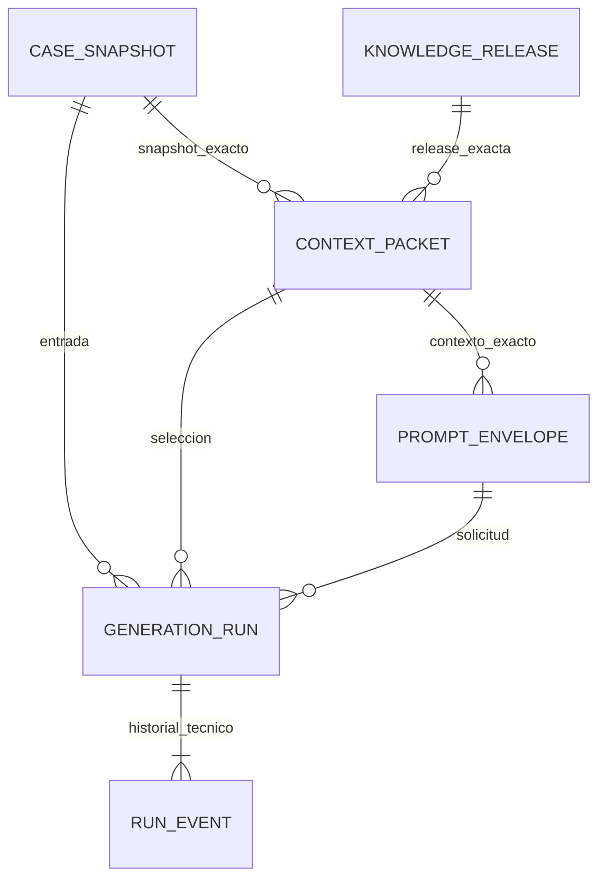

# S1B — Diseño propuesto para persistencia trazable

Estado: diseño aprobado por el usuario en esta conversación; implementado y sujeto a los resultados registrados en S1B-REPORT.md.

Base comprobada: PR #12 abierto, commit `f40da22b6cdcc8bff4cc0d8f969a192c0f909f53`. Clon independiente y rama `feat/rg-das-s1b-run-persistence`.

## Decisión y alternativas

Se propone un repositorio transaccional PostgreSQL mediante TypeORM y seis tablas en el esquema exclusivo `research_ai`: cuatro para artefactos inmutables, una para ejecuciones y una para eventos técnicos. Las entidades de almacenamiento no reemplazan los contratos de dominio S1A.

Un documento único por ejecución simplificaría inserciones, pero dificultaría imponer referencias e identidad inmutable entre artefactos reutilizados. Un sistema completo de event sourcing añadiría reconstrucción, proyecciones y coordinación innecesarias. Las tablas de artefactos, el estado actual versionado y un registro técnico append-only cubren el alcance presente.

## Entidades y referencias propuestas

Las cuatro tablas de artefactos conservan la serialización canónica S1A y su SHA-256. El contexto conserva dentro de esa serialización la política, sus versiones, exclusiones y conflictos. Los índices únicos impiden reutilizar una identidad de snapshot o release con contenido distinto. Claves foráneas y comprobaciones de metadatos mantienen las referencias; triggers rechazan actualización, borrado y truncado de evidencia con el rol ordinario.

La aplicación valida los contratos existentes y reconstruye ContextPacket y PromptEnvelope desde sus artefactos fuente al guardar y recuperar. Compara la serialización exacta y los hashes; no confía sólo en hashes proporcionados por el llamador. La base también comprueba el hash de los bytes almacenados. Ninguna versión se actualiza silenciosamente al cargar.

## GenerationRun

Una ejecución tiene UUID estable, referencias a snapshot/contexto/envelope, configuración canónica e inmutable, versión del workflow y del contrato de ejecución, ámbito y clave opacos de idempotencia, hash de solicitud, estado, revisión monotónica, timestamps de base de datos, intento y vencimiento de su reserva de ejecución.

La configuración admite únicamente campos explícitos para workflow y selección/configuración del futuro modelo; no admite un diccionario arbitrario de credenciales o headers. Los errores conservan código técnico tipado y fase; no almacenan objetos Error, stacks ni respuestas crudas. Los identificadores externos del proveedor, cuando existan, se registran como referencias opacas de un intento.

Los eventos contienen transiciones técnicas y su revisión; no representan aceptación profesional ni métricas científicas.

## Escritura, idempotencia y concurrencia

`registerRun` valida y almacena los cuatro artefactos, la configuración, la ejecución y su primer evento en una transacción corta. Una respuesta satisfactoria implica commit antes de que S1C pueda invocar al proveedor. Repetir ámbito/clave y contenido devuelve la misma ejecución; reutilizar la clave con otra solicitud produce un conflicto explícito. Un fallo intermedio revierte toda la escritura.

Una reserva atómica cambia `PENDING` a `RUNNING`, incrementa la revisión y devuelve un identificador exclusivo de intento y su vencimiento. Bloqueos de fila, revisión esperada y token de intento evitan que dos trabajadores reclamen la misma ejecución o que uno obsoleto la modifique. La transacción termina antes de cualquier futura llamada externa.

## Estados y recuperación

- `PENDING`: entrada persistida, todavía sin inicio de ejecución.
- `RUNNING`: intento reservado y registrado antes de acceder al proveedor.
- `FAILED`: error técnico conocido, con clasificación explícita.
- `INTERRUPTED`: reserva vencida; no puede asegurarse si el proveedor recibió o completó una futura solicitud.

Se permite registrar el fallo de un intento vigente y volver a `PENDING` tras un fallo expresamente recuperable y conocido. Una reserva vencida se transforma de forma atómica en `INTERRUPTED` y se agrega su evento. No se repiten automáticamente llamadas de resultado incierto. Reconciliar ese estado y completar una ejecución con resultados quedan para S1C/S1D; S1B no puede declarar éxito de generación sin un resultado persistido.

Al crear una nueva instancia del repositorio, los datos y estados se reconstruyen desde PostgreSQL. Se ofrece una consulta acotada de pendientes/ejecuciones vencidas; no se introduce worker ni planificador de producción.

## Composición y migraciones

Se mantendrá la implementación, su migración específica y la configuración aislada de pruebas bajo `src/modules/research-ai/`, con documentación bajo `docs/research-ai/` y `architecture-analysis/`.

La configuración actual sólo descubre migraciones en `src/migrations/`. Para no ampliar el alcance, S1B proporcionará el conjunto explícito de entidades/migraciones y un punto de composición del subdominio. Las pruebas usarán un DataSource dedicado. No se añadirá aún Research AI a AppModule ni se cambiarán los descubrimientos globales de entidades/migraciones. La activación operativa futura requerirá una decisión explícita y aplicar la migración con permisos adecuados.

## Validación prevista

PostgreSQL 16 o 17 aislado en un contenedor nuevo, sin reutilizar volúmenes ni bases operativas. El entorno dispone de imágenes PostgreSQL y acceso autorizado a Docker. Se usarán sólo datos sintéticos RT-F04 y credenciales efímeras de prueba sin registrarlas en Git ni informes.

Pruebas de integración reales: migración arriba/abajo en base descartable; recuperación exacta tras cerrar/reabrir conexión; inmutabilidad por SQL; hash alterado; referencias inválidas; identidad duplicada con otro contenido; idempotencia concurrente; reserva concurrente; intento obsoleto; rollback de transacción; estados inválidos; fallo recuperable; recuperación de reservas vencidas sin reintento automático. Se conservarán las pruebas S1A y se ejecutarán build, tipado, lint sin autofix y diff check.

Si PostgreSQL no pudiera ejecutarse, se documentará la falta de evidencia y no se declarará validada la persistencia ni se creará el commit condicionado a esas pruebas.

## Límites de seguridad y preparación para S1C

El hash prueba integridad del contenido, no autoría ni autorización. Un propietario/superusuario PostgreSQL puede desactivar protecciones: el despliegue debe separar el rol migrador del rol de aplicación. El almacén no es una frontera HTTP y no autentica usuarios; sólo un futuro servicio autorizado debe llamarlo. El ámbito de idempotencia no sustituye autorización.

Los contratos S1A permiten texto libre en algunas fuentes; no existe garantía universal de ausencia de datos sensibles dentro de ese texto. S1B usa fixtures sintéticos y no registra payloads en logs. Antes de datos reales harán falta permisos, retención, eliminación autorizada y tratamiento de datos personales.

S1C añadirá ModelGateway real, invocaciones y respuestas observables, persistencia de RawModelDraft y reconciliación de resultados inciertos. S1D incorporará AssuranceReport y publicación inmutable de SystemProposal con reglas de aceptación. No se crean tablas vacías ni simuladores de esos subsistemas en S1B.

## Entrega

Informe con evidencias, diagrama de entidades, límites, archivos y códigos de salida. Un único commit local sólo tras pasar las comprobaciones necesarias. Sin push, PR, merge, cambios a controles de calidad ni modificaciones a los PR existentes.
