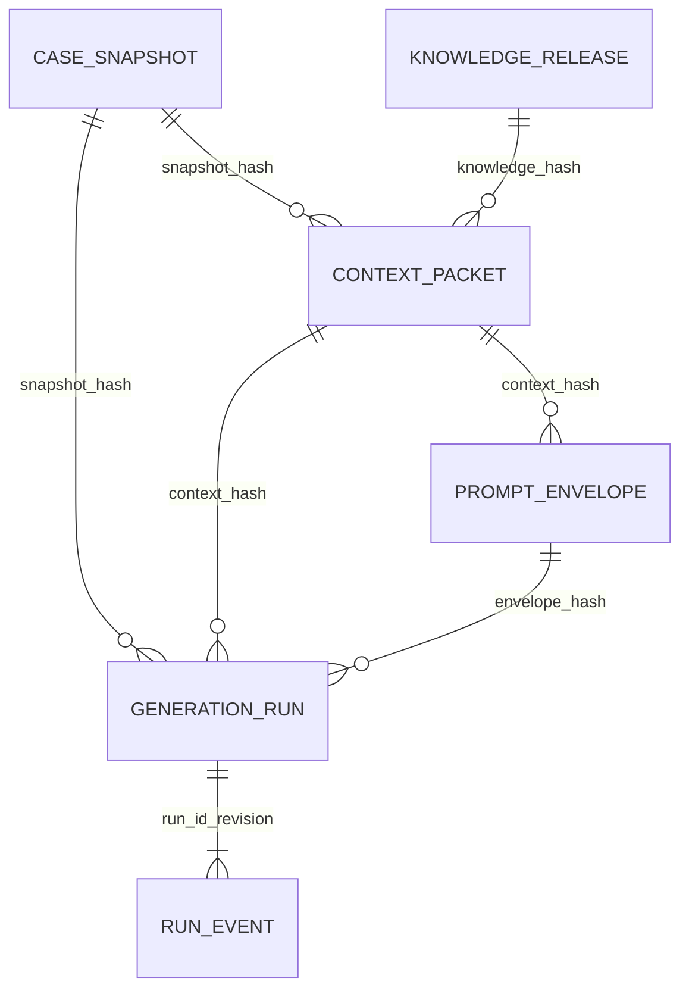

# RG-DAS S1B — Informe de implementación y validación

S1B implementa persistencia PostgreSQL real de entradas y estados técnicos de generación. Se verificó localmente con 78 pruebas aprobadas, incluyendo 22 de integración PostgreSQL. No se conecta todavía a la aplicación operativa ni a un proveedor LLM. RT-F04 sigue siendo una prueba de ingeniería; estos resultados no validan científicamente una prescripción.

## Base y aislamiento

Repositorio: Enduren-uabc/back-enduren. Clon independiente `rg-das-s1b-run-persistence`, rama `feat/rg-das-s1b-run-persistence`. Base exacta: `f40da22b6cdcc8bff4cc0d8f969a192c0f909f53`, correspondiente a `feat/rg-das-s1a-secure-integration`. El [PR #12](https://github.com/Enduren-uabc/back-enduren/pull/12) se comprobó abierto y con ese mismo HEAD; se repitió la consulta el 19 de octubre de 2026 antes del cierre.

No se modificaron clones originales, PR existentes, AppModule, configuración global, workflows, dependencias, tablas operativas ni controles SonarCloud/Codacy. El alcance nuevo se limita a `src/modules/research-ai/`, `docs/research-ai/` y la documentación exigida en `architecture-analysis/`. Se conserva el código S1A sin modificaciones.

El diseño de [S1B-DESIGN.md](S1B-DESIGN.md), incluyendo seis tablas y ausencia de reintento automático ante resultados inciertos, fue aprobado por el usuario. La entrega se conserva en un único commit local sobre la base indicada. El SHA se obtiene con `git rev-parse HEAD` y se entrega en la respuesta de cierre; no se incorpora su propio hash dentro del commit. No se hizo push, PR ni merge.

## Entidades, contratos y responsabilidades

El [diagrama ER del diseño](S1B-DESIGN.md#entidades-y-referencias-propuestas) representa estas referencias:



| Pieza | Responsabilidad |
|---|---|
| `domain/generation-run.ts` | GenerationRun, estados, configuración cerrada, errores e historial técnicos; revisión e intento estables |
| `application/run-persistence.port.ts` | ResearchArtifactReader, ResearchRunStore, RegisterRunInput, StoredRun y AttemptGuard; reutiliza contratos S1A |
| `application/persisted-artifacts.ts` | Revalidar documentos, reconstruir contexto/envelope y calcular identidad canónica de solicitud |
| `infrastructure/persistence/postgres-artifact-repository.ts` | Guardar y reconstruir cuatro artefactos, con el gestor de la transacción recibida |
| `infrastructure/persistence/postgres-run-store.ts` | Registro atómico, lectura coherente, reserva, fallo, reintento explícito y recuperación |
| `infrastructure/persistence/research-records.ts` | Seis EntitySchema separados del dominio |
| `infrastructure/persistence/storage-errors.ts` | Evitar propagar SQL, parámetros y payloads de errores ORM; exponer código fijo y SQLSTATE opcional |
| `infrastructure/persistence/research-persistence.module.ts` | Composición Nest opt-in y token RESEARCH_RUN_STORE; sin importación en AppModule |

Estas rutas son relativas a `src/modules/research-ai/`. El [modelo de arquitectura](../../architecture-analysis/architecture-model.json) y la [guía de componentes](../../architecture-analysis/06-human-component-guide.md) documentan contratos, dirección de dependencias y evidencia sin presentar como activa una integración futura.

## Migración e integridad

`ResearchRunPersistence1792368000000` crea exclusivamente el esquema `research_ai`, sus seis tablas, índices y funciones. Su ejecución se probó con `runMigrations({ transaction: 'all' })`, reversión y reaplicación. No requiere extensiones PostgreSQL ni dependencias nuevas. Su reversión elimina el esquema completo y sólo debe usarse en bases descartables o recuperación expresamente autorizada.

Los cuatro artefactos se almacenan como texto canónico y SHA-256 del documento completo. Para ContextPacket y PromptEnvelope ese hash de almacenamiento es distinto del `contentHash` interno S1A. Se conservan la política de selección y todas sus versiones dentro del documento; no se actualizan al leer.

La base verifica hash de bytes, límite de 1 MiB por documento, identidades únicas y referencias. Claves foráneas compuestas impiden asociar una ejecución con snapshot/contexto/envelope incompatibles. Triggers comprueban las trazas entre documentos y rechazan mutación, borrado o truncado de evidencia. La validación semántica completa y la reconstrucción determinista pertenecen al adaptador; las restricciones SQL no sustituyen todos los contratos de dominio.

La configuración es inmutable y tiene hash. Los eventos se escriben mediante trigger en la misma transacción que el estado; no son decisiones de revisión profesional. No se implementan métricas científicas de esfuerzo residual.

## Atomicidad, concurrencia y recuperación

`registerRun` persiste cuatro documentos, configuración, estado PENDING y evento REGISTERED en una sola transacción. El retorno satisfactorio ocurre después del commit. Reutilizar ámbito/clave y contenido devuelve la misma ejecución; cambiar el contenido produce IDEMPOTENCY_CONFLICT. Un bloqueo asesor por ámbito/clave serializa duplicados, y un bloqueo compartido de la fila existente mantiene coherencia si se reclama al mismo tiempo. Colisiones del hash del bloqueo sólo implican espera adicional.

`claimRun` usa estado PENDING y revisión esperada para crear un intento único con reserva de 1 a 3600 segundos. No conserva transacción ni conexión reservada para una llamada externa. `getRun` usa REPEATABLE READ para observar estado y eventos en una misma instantánea. Actualizaciones de intento requieren revisión, token vigente y reserva no vencida.

Se admite un único identificador opaco de invocación por intento. Los fallos explícitamente recuperables pueden volver a PENDING, manteniendo los eventos anteriores. Las reservas vencidas pasan a INTERRUPTED mediante bloqueo de filas y SKIP LOCKED. Ese estado no se reintenta automáticamente ni se declara exitoso. S1B no tiene estado de éxito porque todavía no persiste una respuesta del modelo.

La suite verificó recuperación exacta después de cerrar/reabrir todas las conexiones de aplicación y desde un proceso Node nuevo, sin memoria compartida. También verificó recuperación concurrente de reservas vencidas sin duplicar eventos. No se probó reinicio del servidor PostgreSQL, pérdida de alimentación ni arranque HTTP completo de Nest.

## Validación ejecutada el 19 de octubre de 2026

Entorno: Node 22.23.3, pnpm 11.1.1, TypeScript 5.9.3, TypeORM 0.3.29 y PostgreSQL 16.15 en contenedor aislado `postgres:16-alpine`. PostgreSQL tenía `fsync=on` y `synchronous_commit=on`. El almacenamiento era tmpfs descartable y sólo se usaron datos sintéticos RT-F04. Esto acredita persistencia entre procesos mientras la base existe; no es una prueba de durabilidad física del servidor.

La base se limitó a `127.0.0.1` y al nombre `rg_das_s1b_test`, con credenciales aleatorias efímeras en archivos privados fuera de Git. La migración usa un rol administrador de esa base descartable; la mayoría de operaciones de repositorio usan un rol separado con permisos mínimos. Las pruebas adversarias de restricciones usan también el propietario para comprobar triggers. No se leyó el `.env` de la aplicación.

| Comprobación | Resultado observado | Salida |
|---|---|---:|
| Instalación con lockfile congelado | Sin cambios a manifiestos ni lockfile | 0 |
| Jest focalizado, integración PostgreSQL habilitada | 6 suites, 78/78 casos, 0 omitidos; 11.95 s | 0 |
| Pruebas S1A conservadas | 50/50, incluidas en el total | 0 |
| Validación de artefactos S1B | 6/6, incluidas en el total | 0 |
| Integración PostgreSQL real | 22/22, incluidas en el total | 0 |
| Build NestJS | Aprobado | 0 |
| TypeScript estricto en Research AI, incluidas pruebas | Aprobado | 0 |
| ESLint focalizado sin autofix | Aprobado | 0 |

Los casos cubren igualdad canónica de los cuatro artefactos, snapshots S1A v0 y v0.1, idempotencia concurrente con contenido igual y diferente, identidad inmutable, hashes incorrectos, relaciones inválidas, contexto manipulado con hash recalculado, escritura de eventos no autorizada, rollback por fallo al insertar evento, reservas competidoras, lectura concurrente con registro/reserva, intento obsoleto, transición inválida, recuperación de fallo conocido y de reserva vencida.

La inyección de un fallo real en el trigger de eventos revierte también los artefactos nuevos. La prueba confirma además que el error público no contiene SQL, parámetros, driverError ni datos del snapshot. El consumidor futuro debe usar ResearchRunStore como frontera pública, no invocar directamente el repositorio auxiliar.

Comandos ejecutados desde el clon, con Node 22 disponible en PATH:

```sh
pnpm install --frozen-lockfile
RESEARCH_AI_TEST_DB_CONFIG=/tmp/rg-das-s1b-verification/database.json \
  node node_modules/jest/bin/jest.js --runInBand \
  --testPathPatterns=modules/research-ai --json \
  --outputFile=/tmp/rg-das-s1b-verification/jest.json
node node_modules/@nestjs/cli/bin/nest.js build
node node_modules/typescript/bin/tsc --noEmit --strict --target ES2023 \
  --module commonjs --moduleResolution node --esModuleInterop \
  --experimentalDecorators --emitDecoratorMetadata --skipLibCheck \
  $(rg --files src/modules/research-ai -g '*.ts')
node node_modules/eslint/bin/eslint.js 'src/modules/research-ai/**/*.ts'
git diff --cached --check
```

Para reproducir la integración se necesita una base PostgreSQL nueva y descartable con ese host/nombre y un archivo privado JSON que contenga `host`, `port`, `database`, `username` y `password`. La suite crea y elimina su esquema y rol; no debe apuntarse a datos que se quieran conservar. La prueba de proceso nuevo hereda únicamente la ubicación de esa configuración. No se versionan el archivo, logs privados, dependencias ni datos de PostgreSQL.

Sin RESEARCH_AI_TEST_DB_CONFIG la suite PostgreSQL se omite deliberadamente; una ejecución así no acredita persistencia. La ejecución reportada sí la habilitó y no omitió casos.

Incidencias resueltas durante desarrollo: la primera ejecución no pudo abrir conexiones TCP por aislamiento del entorno; la ejecución autorizada permitió PostgreSQL real. TypeORM rechazó inicialmente una propiedad de transacción de migración incompatible con modo `all`; se eliminó esa propiedad. Un caso detectó un error síncrono en una operación asíncrona y se corrigió. El tipado detectó un arreglo readonly de un fixture v0 y se corrigió la copia. También se añadió el bloqueo de lectura para evitar una carrera entre repetición idempotente y reserva. Las ejecuciones finales anteriores corresponden al código corregido.

No se ejecutaron suites históricas ajenas al subdominio ni lint global. No se atribuye un estado verde a esas comprobaciones. No se ejecutó GitHub Actions, SonarCloud o Codacy para este cambio local.

## Riesgos y decisiones antes de activación

- Un rol propietario/superusuario puede desactivar triggers. Separar migrador y aplicación es obligatorio para que las restricciones constituyan la protección prevista; el migrador no debe usarse en runtime. La migración no crea roles globales de producción.
- Hashes detectan alteraciones, pero no prueban autoría ni autorización. El puerto es interno; ámbito de idempotencia y runId no autorizan acceso. Falta un consumidor con permisos por caso.
- Campos de texto de S1A pueden contener información sensible. Los fixtures son sintéticos, pero el código no es un sistema general de detección de secretos. Deben definirse minimización, cifrado, respaldo, retención y eliminación autorizada antes de datos reales. No activar logging de consultas con parámetros en el DataSource futuro.
- Los errores ORM se reducen a códigos; S1C necesitará observabilidad segura sin volver a introducir payloads o secretos en logs. Una configuración cerrada reduce campos arbitrarios, pero no impide que un llamador malicioso coloque un secreto dentro de un identificador permitido.
- Reservas vencidas no se renuevan en S1B. S1C debe fijar tiempos, cancelación y reconciliación; un timeout de red por sí solo no prueba que el proveedor rechazó la solicitud. El llamador es responsable de clasificar como recuperable sólo un resultado conocido.
- No se promete exactly-once frente al proveedor. Las transacciones cubren PostgreSQL, no la API externa. El registro externo y los eventos previenen pérdida silenciosa de intención, pero no eliminan la ventana de resultado incierto.
- Lecturas reconstruyen los documentos para validar integridad y pueden repetir consultas; adecuado al alcance mínimo, sin mediciones de carga ni promesa de rendimiento. Las consultas de pendientes/recuperación están acotadas a 100 filas.
- Timestamps devueltos por TypeORM/JavaScript tienen resolución de milisegundos. El orden técnico se define por revisión monotónica, no por unicidad temporal.

## Preparación para S1C y S1D

S1C deberá conectar ModelGateway real después de confirmar registro y reserva, definir credenciales fuera de configuración persistida, límites del proveedor, identificador e idempotencia externa, timeout y reconciliación. Añadirá invocaciones, respuesta observable, metadatos y RawModelDraft enlazados a runId/attemptId. La respuesta deberá persistirse antes de añadir una transición de éxito. No existe una API simulada como producto.

S1D añadirá AssuranceReport y SystemProposal publicada e inmutable, junto con decisiones profesionales diferenciadas de eventos técnicos. No se anticiparon tablas vacías ni subsistemas de revisión.

Antes de activar el módulo debe registrarse explícitamente la migración en un DataSource dedicado, incorporar RESEARCH_ENTITIES y decidir la importación de ResearchPersistenceModule. El descubrimiento global actual no incluye esta migración. No se amplió ese alcance sin autorización. Antes de publicar corresponde revisar este commit local y el estado de integración del PR #12; no se debe cambiar la base silenciosamente ni duplicar su integración.

## Archivos y cierre

La entrega agrega 12 archivos TypeScript (contratos, adaptador, migración y pruebas), este informe, el diseño aprobado y 11 archivos de documentación/modelo en `architecture-analysis/`. El listado completo se obtiene con `git show --name-only --format= HEAD` después del commit local. No se reemplaza ningún archivo de S1A ni se añaden paquetes.

Controles finales aprobados antes del commit, todos con salida 0:

- `git diff --cached --check`: sin errores de espacios ni conflictos de parche.
- Auditoría del índice: exactamente 25 archivos nuevos de texto en las tres rutas autorizadas; ningún archivo existente modificado. Comparación byte a byte de todos los archivos S1A versionados con la base, aprobada.
- Workflow, manifiestos, lockfile, AppModule y configuración de base de datos idénticos a la base. Sin `.env`, dependencias, logs ni datos de verificación en el índice.
- Inspección de contenido y búsqueda de patrones de credenciales, claves privadas y conexiones con contraseña: sin hallazgos. También se comprobó que la credencial efímera de la prueba no aparece en ningún archivo preparado. Esto no sustituye una garantía universal de detección de secretos.
- Modelo de arquitectura: validador oficial de la skill con validación básica (jsonschema no estaba instalado); comprobación adicional de todas las restricciones usadas por el esquema mediante Ajv ya instalado, desactivando sólo la búsqueda del metaesquema draft-2020-12. No se añadieron dependencias. Auditoría de identificadores, rutas, referencias y enlaces locales aprobada.
- Contenedor PostgreSQL propio detenido y eliminado automáticamente tras las pruebas; no se conservó su base tmpfs ni se afectaron otros contenedores.

No quedan bloqueos locales de implementación o validación dentro del alcance aprobado. Los pendientes de activación, privacidad y S1C descritos arriba siguen abiertos. La publicación requiere una instrucción posterior; esta entrega termina en el commit local.
